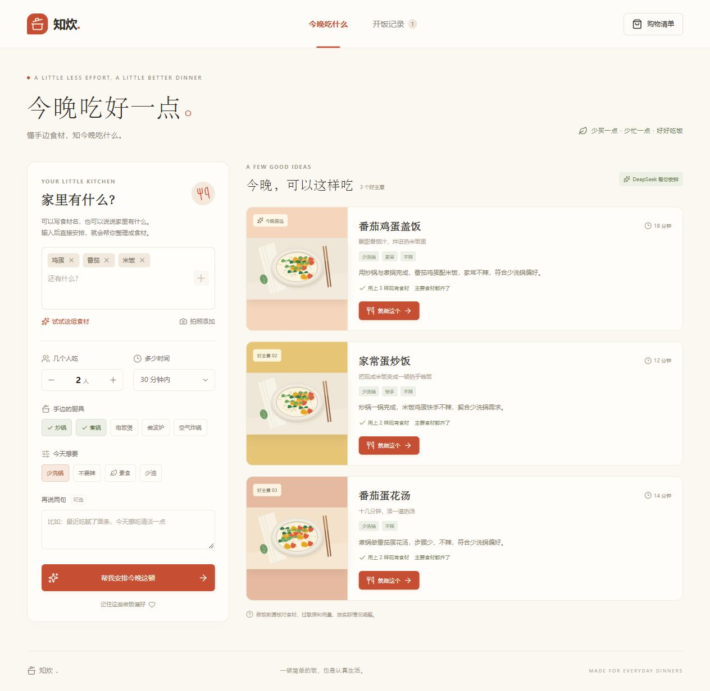
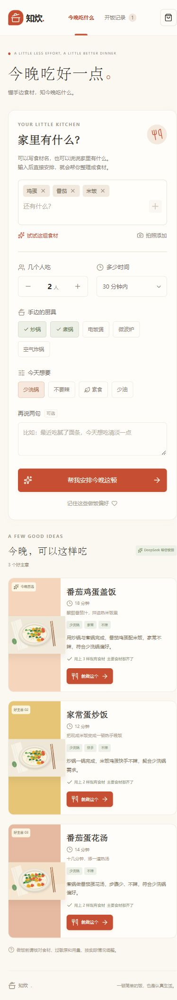

# 知炊 · Zhichui

懂手边食材，知今晚吃什么。

知炊是一款面向日常下厨的全栈应用：输入食材、人数、时间和厨具，获得可执行的家常菜建议，再跟着步骤完成烹饪。做过的菜、口味反馈和购物清单保存在服务端，下次打开仍然可用。

将“想吃什么、还缺什么、怎么做”放在一个流程中，减少查菜谱、切换工具和重复列清单的操作。仓库包含前端、后端 API、数据库迁移、测试和实际界面截图，可按下方步骤在本地运行。

## 能做什么

- **现有食材推荐**：匹配 20 道家常菜模板，显示已备食材和缺少的材料，按人数估算用量。支持食材列表和常见口语描述，整理后的食材名称会显示出来供核对。
- **理解自然语言要求**：通过 DeepSeek 提取备注中的口味和忌口，为候选菜提供推荐理由。时间、设备和已识别的忌口由程序再次校验。
- **照片添加食材**：上传 JPG、PNG 或 WebP，调用视觉模型识别可能的食材名称，核对后再加入厨房。
- **分步做饭**：查看准备工作、烹饪步骤和页面内计时器，保存当前进度，完成后记录反馈。
- **购物清单**：把缺少的材料加入清单，勾选已购买、手动添加或删除；重复加入同一菜谱不会反复累加用量。
- **厨房记录**：保存偏好、历史菜谱和反馈，在后续推荐中降低最近做过或不喜欢的菜的优先级。

推荐以单道菜为单位，包含主食、配菜和汤，并非自动生成营养套餐。用量和时间为估算；常备油盐和水单独标注。计时提醒在页面打开时显示。

例如输入“家里只剩下面粉和鸡蛋了还有几棵青菜，还有辣椒”，会整理为“面粉、鸡蛋、青菜、辣椒”。未知名称会保留并提示核对；没有结果时会区分菜谱库未覆盖、时间不足、缺少厨具或忌口冲突。少碳水等要求用于相对排序，不提供营养含量保证。

## 界面

桌面端：按现有食材匹配菜谱，并显示实际 DeepSeek 推荐状态。



手机端：食材、时间、厨具和偏好依次排列。



## AI 与程序如何协作


菜谱、配料和步骤来自项目内的固定模板，模型不会直接覆盖它们。模型不可用时，应用明确显示模板推荐模式；照片识别失败则显示错误，不会用示例食材冒充结果。未配置模型密钥时，文字输入、模板推荐和数据保存仍然可用。

## 技术结构

| 部分 | 实现 |
| --- | --- |
| 页面与交互 | React 19、TypeScript、响应式 CSS |
| 服务端 | Vinext 的 App Router API，运行于 Cloudflare Workers |
| 数据库 | Cloudflare D1（SQLite）、Drizzle schema 与 SQL migrations |
| 模型调用 | 服务端调用 DeepSeek JSON 输出与视觉接口 |
| 身份与数据 | 托管环境使用 Sites 用户身份，查询按用户隔离 |

主要目录：

```text
app/page.tsx                   页面、烹饪交互、历史与购物清单
app/api/                       推荐、设置、记录、清单、图像识别 API
lib/meal-engine.ts             食材归一化、条件过滤、用量与推荐排序
lib/recipes.ts                 家常菜模板
lib/server/deepseek.ts         模型请求、结果解析与超时处理
lib/server/store.ts            按用户读写数据库
db/schema.ts                  数据表定义
drizzle/                      版本化数据库迁移
tests/meal-engine.test.ts      核心推荐规则测试
public/food/                  项目自制 SVG 食物插画
```

## 本地运行

需要 Node.js 22.13 及以上版本；核心测试使用 Node.js 24 验证。

```bash
git clone https://github.com/mingyu87961-svg/zhichui.git
cd zhichui
npm ci
npm run build
npm run db:local
npm run dev
```

打开终端输出的本地地址（默认 `http://127.0.0.1:5173`）。本地开发使用开发身份，无需 ChatGPT 登录；本地数据库保存在被 Git 忽略的 `.wrangler/state`。首次启动前需执行数据库迁移。后续新增迁移时重新运行 `npm run db:local`。

启用 AI 时，将 `.dev.vars.example` 复制为项目根目录的 `.dev.vars`，填入自己的密钥：

```dotenv
DEEPSEEK_API_KEY="你的密钥"
DEEPSEEK_MODEL="deepseek-flash"
DEEPSEEK_BASE_URL="https://api.deepseek.com"
```

保存后重启开发服务。`.dev.vars` 已被 Git 忽略。密钥只由服务端读取，不发送给浏览器；托管部署需通过平台的环境变量配置服务端密钥。

```bash
npm run check                  # TypeScript
npm test                       # 推荐引擎与约束测试
node scripts/check-provider.mjs # 可选：实际模型连接检查
```

## API

| 路径 | 用途 |
| --- | --- |
| `GET /api/kitchen` | 当前偏好、历史、清单与 AI 可用状态 |
| `PATCH /api/settings` | 保存厨房偏好 |
| `POST /api/recommend` | 获取最多三个候选菜 |
| `GET /api/recipes` | 菜谱模板 |
| `POST /api/meals` | 保存选定菜谱的快照 |
| `PATCH /api/meals/:id` | 更新步骤、烹饪状态与完成反馈 |
| `GET/POST /api/shopping` | 读取清单、加入缺料或手动材料 |
| `PATCH/DELETE /api/shopping/:id` | 勾选或删除材料 |
| `POST /api/ingredients/recognize` | 上传照片，返回待核对的食材名称 |

写接口校验同源请求和输入大小，模型调用与写操作设有限流。服务端仅接受模板中的菜谱 ID，数据库查询按用户 ID 限定，并验证烹饪状态转换。

## 数据与部署

部署目标是支持 Workers、D1 和 Sites 身份头的环境。公开仓库的 `.openai/hosting.json` 仅声明通用 `DB` 绑定，不包含作者的部署项目 ID。新部署需要使用自己的项目和数据库；`drizzle/` 提供建表迁移。托管数据库与本地开发数据库独立。迁移应在部署流程中执行，不在业务请求中临时建表。

本地体验使用 `npm run dev`。生产模式要求可信平台注入用户身份，匿名业务请求返回 401；直接迁移到其他 Workers 平台时，需要实现相应认证接入，不能信任客户端自行填写的身份头。

偏好、做饭进度、完成记录及购物清单存入 D1。模型请求会将所填写的做饭条件发送给 DeepSeek；仅在用户主动使用照片识别时发送该照片。项目不将上传照片写入数据库或对象存储。照片识别结果和自动提取的忌口仍需用户核对，不能用于判断食材新鲜度或食用安全。

本项目不包含外部菜谱抓取；插画为项目内生成的 SVG 示意图。前端、API 和数据库 schema 均在此仓库中。

框架脚手架包含 OpenAI Sites 的构建与本地预览适配代码，以及 shadcn 样式资源；对应许可证与来源声明保留在 `scripts/vite/sites-vite-plugin.LICENSE`、`vendor/shadcn-tailwind-4.13.0.LICENSE.md` 和相关源文件中。
